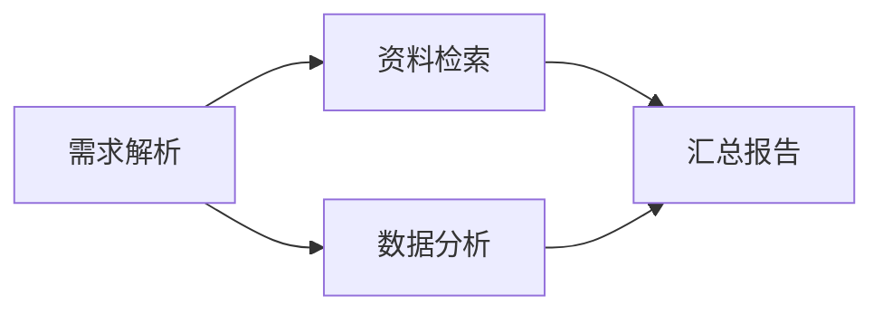

# SOP DAG 编排与局部恢复

新建流程默认采用 DAG。已有流程未设置 `execution_mode` 时继续按原来的顺序执行，已有运行保持启动时的流程快照。

## 使用方式

1. 打开「SOP 流程」，新建或编辑流程，选择「DAG 依赖编排」。
2. 为节点选择执行者、模型和前置节点。不选择前置节点的节点可独立启动；汇合节点等待所有前置节点成功。
3. 使用「每个节点独立」工作区支持并行；「整个运行共享」工作区将节点串行执行，避免并发修改同一文件。
4. 设置最大并行数、每个节点的尝试上限、超时和重试等待时间。自动重试采用有上限的指数退避。
5. 节点失败后，点击「只重试此节点」，保留同一次运行中已成功的其他节点。
6. 修改成功节点的结果时，选择「重做此节点及下游」。依赖旧结果的下游将重新计算，无关分支保留。



在这个流程中，C 失败会阻塞 D，B 仍可完成。重试 C 后，A、B 不会重新执行。

## 定义与数据交接

`SOPData` 增加 `execution_mode: "dag"` 和 `max_concurrency`。`steps` 保留原 API 名称，其中每一项现在可定义：

```json
{
  "id": "report",
  "subject": "汇总报告",
  "description": "根据资料与统计结果生成报告",
  "depends_on": ["search", "analysis"],
  "input_bindings": {
    "sources": "search.sources",
    "metrics": "analysis.metrics"
  },
  "executor": {"agent_id": "YOUR_AGENT_ID", "session_key": "report-worker"},
  "verifier": {"type": "human", "question": "报告是否满足要求？"},
  "output_schema": {"type": "object", "properties": {"summary": {"type": "string"}}, "required": ["summary"]},
  "max_attempts": 3,
  "timeout_seconds": 600,
  "retry_delay_seconds": 2
}
```

依赖必须引用存在的节点，图中不能有环。输入映射只能引用祖先节点的结构化输出，支持 `node_id.field.nested_field`。每个节点还会收到本次运行的全局输入和直接上游的交接说明。

执行者通过 `SubmitHandover(handover, outputs, artifact_paths)` 提交。`outputs` 是 JSON 对象，按可选的 JSON Schema 验证；Schema 只允许本地引用。`artifact_paths` 为相对于工作区的文件路径，最多 20 个文件、合计 32 MiB。文件保存为带 SHA-256 的快照，下游读取前再次校验，并复制到自己的 `inputs/<来源节点>/<哈希前缀>-<文件名>`。审核者和执行者使用不同会话；默认共用该节点本次尝试的工作区。

## 运行操作 API

以下地址均要求当前用户拥有该运行。

| 操作 | 地址 | 请求体 |
|---|---|---|
| 节点重试 | `POST /sop/runs/{run_id}/nodes/{node_id}/retry` | `{"expected_generation": 0, "include_descendants": false}` |
| 重做节点及下游 | 同上 | `{"expected_generation": 0, "include_descendants": true}` |
| 继续就绪节点 | `POST /sop/runs/{run_id}/resume` | `{}` |
| 停止运行 | `POST /sop/runs/{run_id}/cancel` | `{}` |
| 人工审核 | `POST /sop/runs/{run_id}/verdict` | `{"step_index": 0, "expected_attempt_id": "CURRENT_ATTEMPT_ID", "passed": true}` |

从最新运行详情读取 `generation` 和 `attempt_id`。这些值用于拒绝迟到操作。手动重试开启新一轮自动尝试预算；历史尝试、输出和审核意见继续保留。已在运行的节点及其运行中下游不能直接重做。

## 持久调度与恢复

部署入口采用与存储同一 Redis 配置的 `RedisMessageBus`。运行和节点状态是持久调度队列：服务每 5 秒扫描未完成记录，重新计算就绪节点。每个运行使用可续期的协调者锁，节点提交使用短时状态锁；协调者和节点代际标识拒绝旧执行者的迟到结果。重启后保留成功结果，并继续未完成工作或审核；等待工具授权的会话可从持久记录恢复关联。正常停止会释放锁；进程被强制终止时，恢复会等待遗留锁租约过期（协调者锁 60 秒，会话锁使用服务现有租约）。

这是至少一次执行语义。节点在外部动作成功、结果尚未持久化时崩溃，恢复后可能再次执行该动作。发送通知、支付、写入外部业务系统等操作应由对应业务接口使用跨尝试稳定的幂等键，例如 `run_id/node_id/logical_action`。幂等键不要使用会在重试时变化的 `attempt_id`。复杂节点可进一步拆成小节点。

## 可直接体验的本地示例

项目提供新品发布、电商复盘、销售日报三套 DAG 示例，覆盖并行汇合、人工审核、失败隔离及局部恢复。使用虚构数据和本地模拟模型，无需 API Key；执行仍经过真实的调度、会话、工具提交与持久化流程。启动和预置方法见 [本地演示说明](examples/sop_dag_demo/README.md)。

使用账号自己的真实 DeepSeek 模型运行会议纪要、反馈周报、培训筹备，见 [真实模型轻办公任务](examples/sop_office/README.md)。原始业务素材是练习材料，分析、文档和审核结论由模型实际生成。智能体审核会同时收到交接摘要、完整结构化输出和产物信息。

## 验证

`tests/app_sop_dag_test.py` 在 SQLite 和 fakeredis 上验证：分支并行、失败传播、局部重试、下游失效、尝试历史、重启恢复、重复及迟到提交、人工审核边界、取消、Schema 校验、跨工作区文件校验，以及多个协调者共同调度。测试不调用模型。
